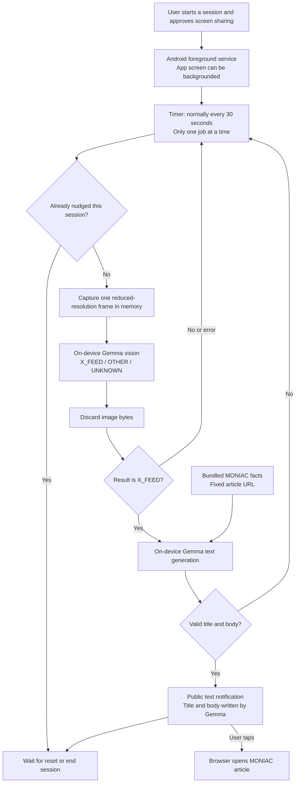
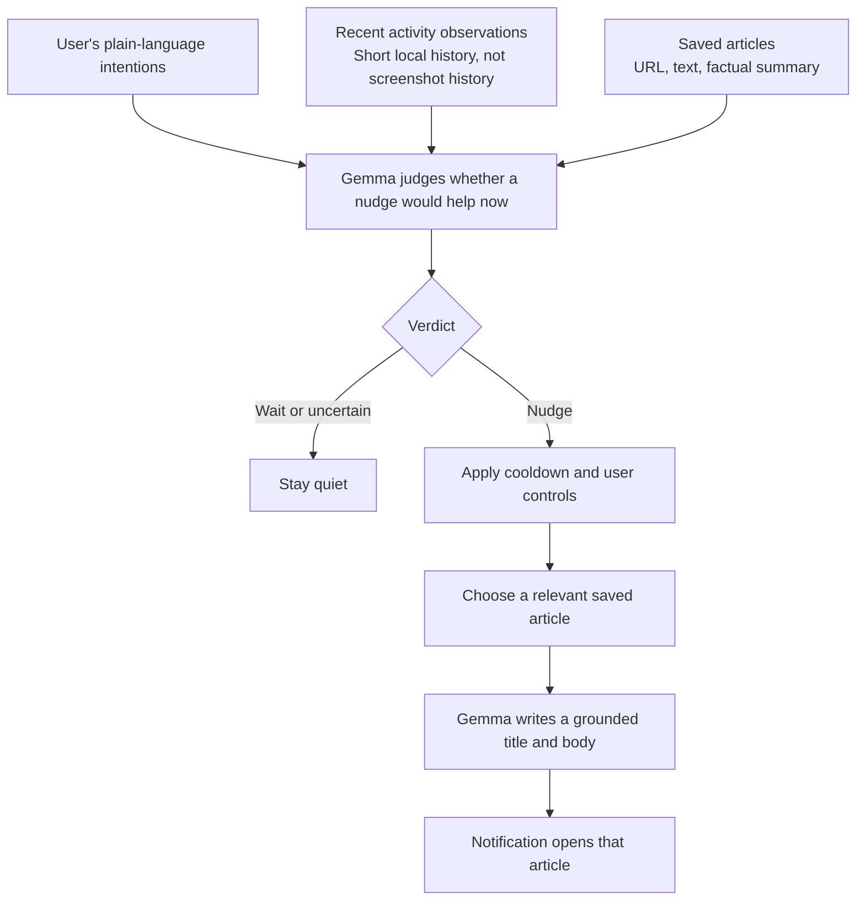

# Current system and a recorded run

This describes the tested Android demo at commit `565476c`, before general article
import or broader judgment rules have been added. Evidence is in
`docs/validation/device-check.json`.

## Current architecture

The X decision is a classifier, not a judgment of whether the user's activity is
healthy or aligned with their intentions. The notification writer is genuinely
generative, but its prompt and factual input are currently specific to MONIAC.
Screen processing and model inference stay on the phone. The app has no Internet
permission; the separate browser can fetch the article when the user opens it.

The foreground service continues after the app screen is left. Android still
shows its capture indicator and service notification. Locking the phone, starting
another projection, or ending the session stops capture; a new session requires
fresh permission.

## Recorded nudge

One saved live run had these measurements:

| Step | Observed result |
| --- | --- |
| Native X feed visible | One image sampled on the phone |
| Gemma vision | `X_FEED` in 2.114 seconds |
| Gemma text generation | Title/body in 16.398 seconds |
| Notification | Visible title/body, generated from the MONIAC fact brief |

**Title:** Water calculating money? What is that?

**Body:** Imagine tanks and valves figuring out money flows with just water. See how this analog machine did the math!

The captured screen was not included in the text-generation conversation. That
conversation received the public article facts. The approximately 18.5 seconds
above excludes waiting for the sampling timer and is a measurement, not a latency
guarantee. The normal timer is 30 seconds; rehearsal can request a five-second check.

Article opening and visible notification text were confirmed by the owner during
testing. In a separate live quiet-screen test, the MONIAC article in the browser
was classified as `OTHER` in 2.498 seconds and produced no nudge.

## Proposed next version — not implemented here

This separates deciding **whether to interrupt**, choosing **what to offer**, and
writing **how to make the offer appealing**. User intent supplies the standard;
the model should abstain when context is insufficient.
