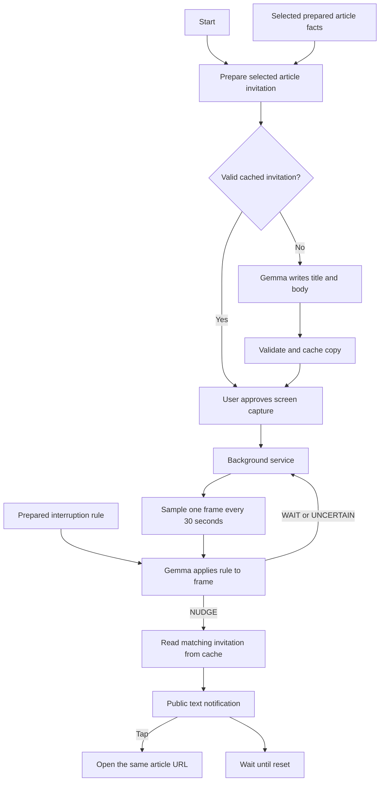

# Prepared-content demo

The demo uses local, prepared article facts so a presentation never depends on
live website fetching or article extraction. The same writer accepts any
`PreparedArticle`; the bundle contains MONIAC, Voyager's Golden Record, and the
Antikythera mechanism. Sources are recorded alongside each fact brief in
`app/src/main/assets/demo-articles.json`.

Gemma receives the plain-language instruction from
`app/src/main/assets/demo-rule.txt`: offer an alternative for social-media browsing,
but stay quiet while writing, communicating, or reading an article. It returns `NUDGE`, `WAIT`, or `UNCERTAIN`. The app enforces
one job at a time and one nudge per session/reset, while Gemma interprets the rule.

The article object is captured at the live verdict. Changing the selection later
cannot pair its copy with the wrong URL. Selection changes also warm the new
article; on a cache miss at delivery, the writer generates real copy before notifying.
The cache records the original generation time separately from lookup latency.

The main screen has a single Start/Pause control. Prepared article selection and
rehearsal controls are collapsed under **Demo controls**. After starting a session,
the screen can be left; the foreground service continues until stopped, the phone
locks, or Android ends projection.

## Later product version

The user's intended product flow is: share a post/article into Elsewhere, resolve
its link, obtain the article text, generate a local factual brief, and save it for
future invitations. A user-entered prompt supplies the interruption rule. Recent
activity and cooldowns can supply context for more nuanced judgment.

Share intake, live URL fetching, and editable personal rules are deliberately
outside this demo. No network permission has been added. The current prompt and
library are prepared assets. Judgment happens at each screen check; notification
writing happens locally ahead of time and is cached for later use.
