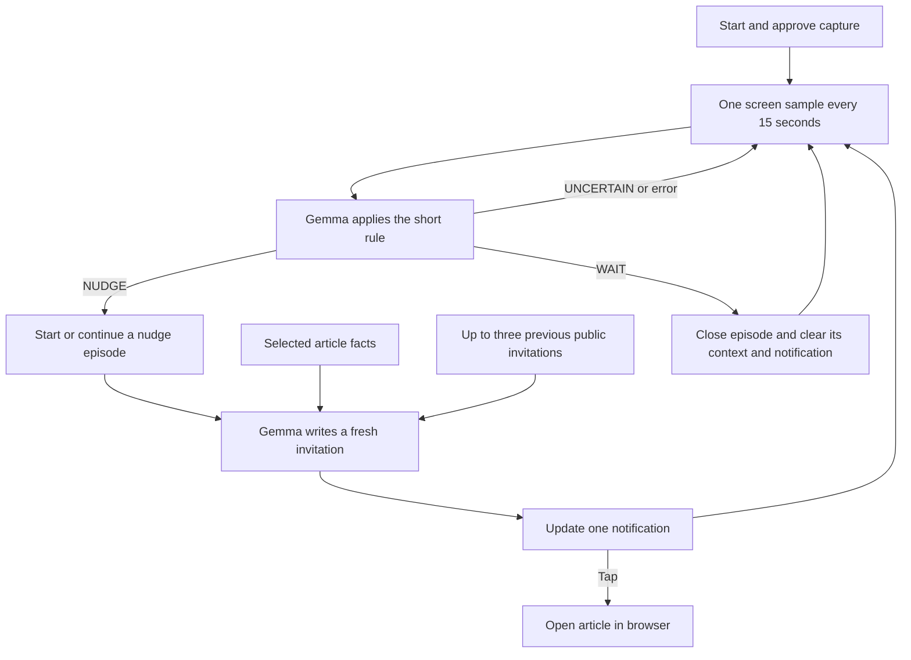

# Live nudge loop

Every 15 seconds, the foreground service samples one reduced-resolution frame
and asks local Gemma to apply the rule: “Nudge me if I'm doomscrolling: passively consuming a social feed or short videos. Otherwise leave me alone.” The
system instruction fixes the NUDGE/WAIT/UNCERTAIN output format and tells Gemma
to ignore Elsewhere's own notification when judging the underlying activity.

An episode is application state, not a persistent model conversation or a Codex
chat. Fresh inference conversations receive a bounded history of public
invitations. Completion discards that history; only aggregate diagnostics remain.
No screen-history archive is created. Reset discards an episode without claiming
success. Monitoring continues after both completion and reset.

Only one screen-and-writing job runs at a time. Checks target 15-second slots;
if inference misses a slot it is skipped, not queued. A screen can change during
generation, so a notification reflects the most recently processed observation.
Android controls whether repeat updates produce visible banners or sound.

The article library contains three prepared factual briefs: Stanford brain origins, Microduck, and Attention Is All You Need (direct arXiv PDF). Gemma is not
yet choosing an item from the library: the demo selector chooses it. Every
notification body is newly generated under the fixed headline “STOP. Read this instead.”; the previous prepared-copy cache is no longer
used. URLs stay paired with the selected article and are not invented by Gemma.

Share intake, article extraction, and editable personal rules remain future work.
The app has no Internet permission; the destination opens in a separate browser.
